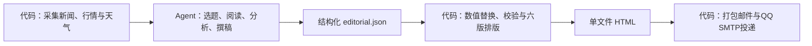

# 赛博日报 · Cyber Daily

一份按个人兴趣编辑的中文报纸：关注时政背后的利益与博弈、事件和股价之间的关系、AI与推理优化进展，也留一页给画作、诗词与哲学。

**当前已跑通：采集材料 → Agent选题与撰稿 → 生成六版HTML → QQ邮箱投递。**选题、阅读和写作由会话中的Agent完成；本仓库尚未实现无人值守的每日生产，也没有独立的多Agent编排或模型API调用。

## 已有功能

| 功能 | 当前实现 |
| --- | --- |
| 四栏目、六个版面 | 时政两版、财经两版、科技一版、艺文一版，各栏目使用不同版式 |
| 阅读体验 | 单文件HTML；桌面对页与纵向阅读切换，移动端适配，键盘翻页，原画放大 |
| 新闻采集 | 配置化RSS/Atom入口、指定网页抓取、失败记录与原始响应留档 |
| 财经数据 | A股、港股、美股指数，四个行业ETF样本，五只演示自选股；程序计算价格变动并保留接口时间 |
| 头版天气 | 吴江汾湖（黎里）定点天气，Open-Meteo数据；中文天气、风向和提醒按代码规则生成 |
| 内容溯源 | 每篇稿件关联来源，报纸内置来源账单，保留逐期稿件、采集数据与统计 |
| 艺文 | 原作图像内嵌、公版诗词原文、Agent撰写的鉴赏；图片与诗词保留来源 |
| 邮件投递 | QQ加密SMTP；正文为天气及栏目导读，附件为完整HTML报纸；本机配置页、Mac钥匙串存储授权码、发送记录与重复投递拦截 |
| X适配器 | 已有官方搜索响应解析与离线导入；实时调用默认关闭，尚未验证真实账号联网，也未自动并入选题流程 |

最新成品：[2026-11-21 周末刊](cyber-daily-2026-11-21.html)。下载后用浏览器打开；GitHub文件页显示的是HTML源代码。

## 哪些由代码完成，哪些由Agent完成



| 环节 | 代码 | 当前Agent |
| --- | --- | --- |
| 材料收集 | 抓固定入口和选定原文，保存响应与时间 | 补充搜索、选择值得继续阅读的材料 |
| 选题和写作 | 提供候选与结构化数据 | 挑新闻、写标题与导语，做时政、财经、科技分析及艺术鉴赏 |
| 数值 | 读取行情与天气，计算涨跌和相对表现，替换稿件占位符 | 转录公告、论文中的其他数字并解释含义；这些尚未全部结构化 |
| 检查 | 来源摘录存在性、行情算术、日期及来源关联、页面布局 | 阅读来源并判断论据与结论；没有独立审稿Agent |
| 交付 | 固定模板排版、内嵌资源、生成邮件、SMTP发送、记录状态 | 在会话中调用工具，组织出报与投递 |

来源片段存在于原文，不等同于分析已经得到语义核实。当前代码不会自动判断报道真假或论证是否成立。

**只运行渲染命令会重新排版已有稿件，不会自动写出新一期报纸。**目前的“Agent”是会话中的编辑与工具使用者；没有独立的记者、分析师或审稿人进程。

## 当前验证结果

截至2026-11-21，最新一期的实际记录如下，详见[来源与分工账单](data/editions/2026-11-21/PROVENANCE.md)：

- 39个RSS入口，33个取得有效条目，共2,155条候选。
- 最终采用20条来源记录，涉及16个域名；来源记录与RSS入口分别计数。
- 18个行情标的，108个原始字段值；代码计算36个单标的派生值、3个比较值。
- Agent撰写46个稿件块、71段、7,471个非空白字符；不含行情占位符、天气条、诗词原文和界面文字。
- 浏览器验证覆盖1440、820和390像素宽度，四栏目翻页、对页与纵向阅读、来源账单和原画放大；检查摘要随期保留，截图可重新生成。
- 邮件模块8项离线测试通过。真实QQ账号认证、Mac钥匙串读取及两次指定地址投递已跑通，QQ服务器均返回接受；服务器接受与最终进入收件箱分别确认。
- X实际采用0条，没有运行独立审稿Agent。

这些是历史快照，不是实时行情、天气或持续运行的服务。

## 运行环境

- Python 3.9及以上：Python脚本仅使用标准库，无需安装第三方依赖；当前在macOS Python 3.9.6验证。
- 邮件凭证管理使用macOS的`security`命令和钥匙串，发送锁使用`fcntl`；Windows与Linux的凭证管理尚未适配。
- 浏览器布局检查为可选项：当前使用Node.js 24与Google Chrome验证。脚本内Chrome路径目前按macOS安装位置固定。
- 抓取和发信需要网络。已有成品可离线打开，已有稿件可离线重渲染。

## 快速使用

### 1. 看现成报纸

克隆仓库后，用浏览器打开根目录的`cyber-daily-2026-11-21.html`。图片、样式和交互脚本均内嵌在文件中。

### 2. 重新排版已有期次

在项目根目录执行：

```sh
python3 pipeline/render_daily.py --edition 2026-11-21
```

这会读取当期采集数据、稿件、天气和原作图像，校验后更新成品、来源账单与统计。部分行情比较需要稿件中指定的前一期存档，仓库已保留相应材料。

可选的浏览器检查：

```sh
node pipeline/preview_sample.mjs --edition 2026-11-21
```

检查摘要与截图输出到当期`preview/`目录；截图不入Git。

### 3. 配置并发送邮件

```sh
cp config/mail.example.json config/mail.json
```

编辑`config/mail.json`，填写QQ发件地址、显示名和收件地址列表。不要在其中填写授权码；该配置文件已被Git忽略。

```sh
python3 pipeline/mail_setup.py --edition 2026-11-21
```

打开终端输出的本机URL。在QQ邮箱开启IMAP/SMTP并生成客户端授权码，粘贴到本机页面，点击“保存并验证”。授权码存入Mac钥匙串；页面提供正文预览和明确的发送按钮。

也可以用命令行处理：

```sh
# 只生成正文、附件和.eml预览，不发信
python3 pipeline/mail_delivery.py --edition 2026-11-21

# 只验证账号，不发信
python3 pipeline/mail_delivery.py --edition 2026-11-21 --check-auth

# 向配置的收件人发送这一期
python3 pipeline/mail_delivery.py --edition 2026-11-21 --send

# 查询本机投递状态
python3 pipeline/mail_delivery.py --edition 2026-11-21 --status
```

同一期、同一组发件人与收件人成功提交后会拦截重复发送。发送中断且结果不明时标为`unknown`并阻止自动重试；请先检查收件箱，再处理记录。程序不会自行定时发信。

完整说明见[QQ邮箱配置](config/MAIL_SETUP.md)。邮件附件目前只有HTML，尚未生成PDF。不同邮箱对HTML附件的预览可能不同，下载后用浏览器打开完整报纸。

### 4. 收集新一期材料

```sh
python3 pipeline/sample_collect.py --edition YYYY-MM-DD --documents /absolute/path/documents.json
```

`documents.json`是包含`id`、`name`、`url`字段的对象数组，可参考[已有选题原文清单](data/editions/2026-11-21/documents.json)。命令同时抓取配置中的RSS及行情；采集当天时默认一并获取天气，可用`--skip-weather`跳过。

补抓原文：

```sh
python3 pipeline/enrich_edition.py --edition YYYY-MM-DD --documents /absolute/path/documents_extra.json
```

**新一期仍需要Agent阅读材料并编写`editorial.json`。**市场时段整理、原画和诗词材料准备、完整稿件及来源关联也需要会话组织；并非采集后直接调用渲染器即可出报。可以参考已有期次的结构，但不能直接换日期复用旧新闻。

`prepare_morning.py`和`prepare_closed.py`分别处理已验证的盘前及周末情形；渲染器仍有英伟达等固定标的比较逻辑，交易所节假日与其他出报时段尚未形成通用处理。

## 目录

```text
README.md                      功能、实际分工与运行方法
PROJECT.md                     完整项目档案，包含历史讨论与早期方案
config/
  sources.json                 RSS及其他信源
  watchlist.json               五只演示股票，不是实际持仓
  weather.json                 汾湖定点天气参数
  culture.json                 艺文选材方向
  x_sources.json               X查询配置，默认关闭
  mail.example.json            邮件账号配置示例
pipeline/
  collect.py                   基础RSS/Atom解析和采集
  sample_collect.py            逐期新闻、网页、行情采集
  enrich_edition.py            补抓选题原文
  prepare_morning.py           盘前快照与历史基准处理
  prepare_closed.py            周末行情日期检查
  weather_collect.py           天气接口、中文映射与规则提醒
  weather_render.py            天气条排版
  render_daily.py              当前日报渲染入口
  render_sample.py              早期样报及共享排版函数
  render_expanded.py            六版样报及共享样式
  preview_sample.mjs           Chrome布局与交互检查
  x_collect.py                 X响应解析、离线导入及可选实时请求
  mail_setup.py                仅监听本机的邮箱配置页面
  mail_delivery.py             邮件生成、SMTP发送及状态记录
  test_mail_delivery.py        邮件测试，使用模拟SMTP与钥匙串
data/editions/<期次>/
  collection.json              采集数据、行情与市场时间说明
  editorial.json               Agent稿件、来源关联与版面结构
  raw/                        原始网页、接口响应与原作图像
  provenance.json             逐稿来源及分工统计
  PROVENANCE.md               人可读的来源与分工账单
  preview/qa.json             浏览器检查摘要
specimen/                      早期版式原型
refs/                          版式参考图
cyber-daily-*.html              可直接打开的历期成品
```

仓库保留历期成品和相应材料，便于审阅、复现与接手；`PROJECT.md`中的早期“待实现”状态以本文及最新记录为准。

## 配置与凭证

- `sources.json`调整固定信源；`watchlist.json`当前为演示清单，尚未换成用户实际自选。
- `weather.json`调整天气坐标与地点；当前校验按北京时间运行。
- X使用`X_BEARER_TOKEN`环境变量。默认不发请求，启用方式及当前限制见[X接入说明](config/X_SOURCES.md)。
- QQ授权码保存在本机钥匙串，不写入Git、项目配置或日志；换电脑需重新配置。
- 本机邮件配置、`.env`、`.local/`投递记录、生成的邮件文件、浏览器截图与Python缓存均被Git忽略。

历史稿件中引用的新闻、诗词及画作按原来源留档，具体来源与图像信息见各期账单。

## 测试

```sh
python3 -m unittest discover -s pipeline -p 'test_*.py' -v
```

现有8项测试覆盖MIME正文与附件完整性、验证不发信、认证失败脱敏、成功后的重复拦截、DATA阶段断线、明确拒绝后的重试、并行发送锁和凭证不进入进程参数。测试使用示例配置、临时文件和模拟SMTP，不读取真实授权码，也不发送邮件。

## 下一步

- 将选题、阅读、撰稿和审稿接入可运行的Agent流程，明确各角色输入输出。
- 为不同栏目固化写作要求、分析深度和事实与推演的边界。
- 完善跨期去重、交易日处理、来源核验与失败恢复。
- 接入真实自选清单；按需启用X。
- 将出报、检查与投递串成统一入口，再增加定时任务。
- 生成PDF/打印版本，完善跨平台凭证管理。
